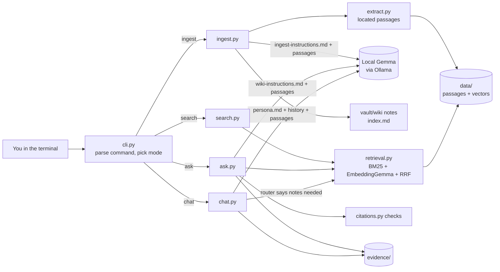
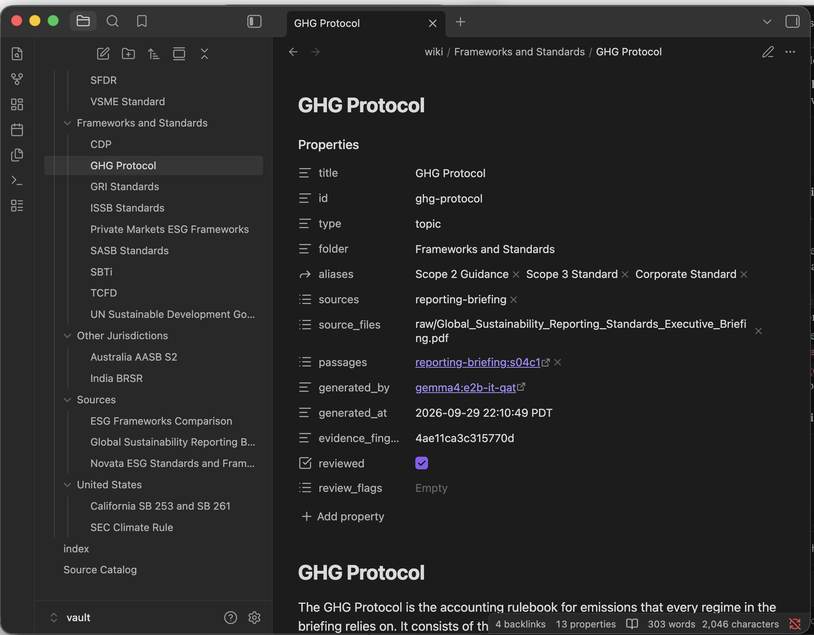
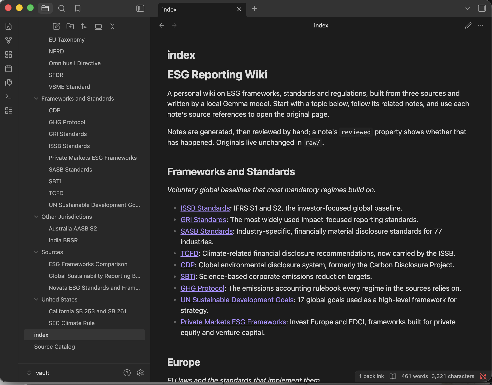
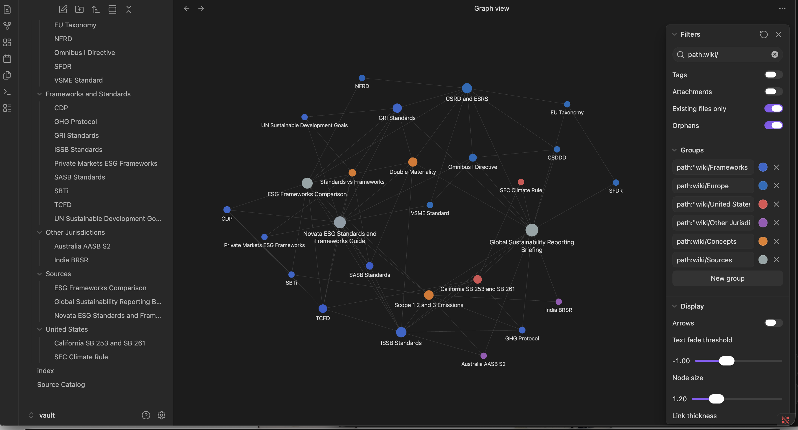

# ESG Reporting Wiki: a local Gemma CLI

A personal wiki about ESG frameworks, standards and US/European sustainability
regulations. It is built from three of my own sources, written and queried by a
local Gemma model, and runs fully offline. I built the CLI and harness myself
(Class 5, Assignment 4).

```
wiki ingest     read sources, write linked wiki notes, rebuild the index
wiki search     show matching original passages (no model answer)
wiki ask        a standalone, cited factual answer, or "insufficient evidence"
wiki chat       talk with Ledger, the assistant; it checks the notes only when needed
wiki test       run the four ask-mode test questions and save evidence cards
wiki modecheck  run the chat/search/ask boundary checks
wiki status     device, network, runtime and model check
```

> All measurements, test results and assessments in this README come from my own runs on my Mac, saved in `evidence/`.

**Contents:** [Sources](#1-purpose-and-sources) · [Setup and device](#2-setup-and-device) ·
[Commands](#3-commands) · [Architecture](#4-architecture) · [Design choices](#5-design-choices) ·
[Evidence](#6-evidence) · [Reflection](#7-reflection)

---

## 1. Purpose and sources

The wiki is a study and reference aid for sustainability reporting. It answers
questions like "who is in scope of SB 253?" or "what replaced the TCFD?" and cites
the page where each answer came from.

| ID | Source | Type | Original file |
|---|---|---|---|
| `esg-frameworks-table` | ESG Frameworks Comparison (my notes, Oct 2024) | Word table comparing 8 frameworks | [vault/raw/ESG_Frameworks.docx](vault/raw/ESG_Frameworks.docx) |
| `novata-esg-guide` | Novata, "GRI, SASB, TCFD & More: ESG Standards & Frameworks, Explained" (Jan 2026) | Web article saved as PDF | [vault/raw/Novata_news.pdf](vault/raw/Novata_news.pdf) |
| `reporting-briefing` | Global Sustainability Reporting Standards: Executive Briefing (my briefing, Sep 2026) | 5-page PDF | [vault/raw/Global_Sustainability_Reporting_Standards_Executive_Briefing.pdf](vault/raw/Global_Sustainability_Reporting_Standards_Executive_Briefing.pdf) |

**How originals connect to generated pages**

- Originals stay unchanged in `vault/raw/`. The catalog `config/sources.yaml` gives
  each one a machine ID and a readable title. `wiki ingest` writes the same table to
  [vault/Source Catalog.md](vault/Source%20Catalog.md), with SHA-256 hashes.
- Each source gets a **source note** in `vault/wiki/Sources/`. Each topic
  (for example CSRD and ESRS) gets a **topic note** built from the passages that
  mention it.
- Every fact in a note links to the original file and page, for example
  `[[raw/Global_...Briefing.pdf#page=2|Briefing p.2]]`. Obsidian opens the PDF at that page.
- Machine IDs such as `reporting-briefing:s06c1` stay in note properties
  (`id`, `sources`, `passages`), never in filenames.

**Known conflicts in the sources** (kept, not "fixed"): Novata (Jan 2026) says over
36 jurisdictions committed to ISSB, while the briefing (as of April 2026) says 28
adopted and 12 more planned. My 2024 table also predates the 2026 Omnibus changes to
CSRD scope.

---

## 2. Setup and device

### Device (from `wiki status --save`)

| | |
|---|---|
| OS | macOS 26.5.2 |
| Chip | Apple M1 |
| Total memory | 8 GB unified memory (CPU and GPU share it; no dedicated VRAM) |
| Available memory before running | about 2.1 GB free of 8 GB (measured by `wiki status` with Obsidian and other apps open) |
| Free disk | 58.7 GB of 245 GB before model downloads; 12.7 GB at the offline run |
| Python | 3.9.6 (macOS system Python, in a virtual environment) |
| Runtime | Ollama 0.35.0 |

### Model choice

| Role | Model | Identifier | Quantization | Download |
|---|---|---|---|---|
| Generation | Gemma 4 E2B, instruction-tuned, quantization-aware trained | `gemma4:e2b-it-qat` (digest `07ea59a47401`, 4.6B total parameters as reported by Ollama) | Q4_0 | 4.3 GB (3.3 GB weights + 1 GB vision projector) |
| Embeddings | EmbeddingGemma 300M | `embeddinggemma` (digest `85462619ee72`, 307.58M parameters) | BF16 (not quantized) | 622 MB |

Why this model fits an 8 GB M1:

- The class guidance says to start with quantized E2B on an 8 GB Apple Silicon Mac.
  E4B (about 4.5 GB at Q4_0 before context) and the 26B MoE (about 14.4 GB) would
  leave too little room for macOS.
- Ollama's default `gemma4:e2b` tag is a 7.2 GB Q4_K_M build, which is too big for
  8 GB. The `e2b-it-qat` tag is Q4_0 with quantization-aware training, so it keeps
  more quality at 4 bits and is 4.3 GB.
- Context is capped at 4,096 tokens for ask and chat and 8,192 for ingest.
  Five passages of about 100 to 200 words each fit comfortably. The KV cache stays small.
- Thinking mode is off (`think: false`), which cuts latency on a small device.
- EmbeddingGemma is small, runs locally in the same runtime, and is from the same
  model family.

Measured on my Mac (from the evidence files):

| Measurement | Value | Where it comes from |
|---|---|---|
| Memory used by the models while answering | Gemma 1.66 GB + EmbeddingGemma 0.68 GB, as reported by Ollama (`/api/ps`) | `memory.ollama_loaded_models` in any ask card |
| Harness process peak memory | 29.5 MB (ask), 68.6 MB (full ingest) | ask cards and ingest report |
| Full ingest (3 sources, 26 notes, 91 embeddings) | 319.4 s (about 5.3 min; 4.8 to 29.7 s per note) | `evidence/ingest/*.md` |
| One ask answer, model time | 16.1 s cold (includes 9.0 s model load); 4.9 to 7.3 s warm; 28.5 to 33.6 output tokens/s | the four ask-test cards |
| Search (no model) | 0.08 s |  `evidence/search/*.md` |

### Install (while online)

```bash
# 1. Ollama: download the macOS app from https://ollama.com/download and open it once
ollama pull gemma4:e2b-it-qat
ollama pull embeddinggemma

# 2. The project
git clone <this repo> esg-wiki && cd esg-wiki
python3 -m venv .venv
source .venv/bin/activate
pip install -e .            # installs the `wiki` command and its 4 dependencies

# 3. Check everything is local and ready
wiki status
```

Dependencies: `numpy`, `pymupdf` (PDF text), `python-docx` (Word), `pyyaml`. HTTP
calls to Ollama use the Python standard library. Model weights are not in the repo.
They come from the Ollama library under the identifiers above.

---

## 3. Commands

| Command | What it does |
|---|---|
| `wiki --help` | Commands, configuration files, required inputs |
| `wiki status [--save]` | Device specs, internet on or off, Ollama version, installed models and digests, loaded memory |
| `wiki ingest [path] [--force] [--index-only]` | Reads `vault/raw/` (or one file in it), writes notes, `index.md` and `Source Catalog.md`, rebuilds `data/` |
| `wiki search "double materiality" [-k 5] [--wiki] [--method keyword] [--save]` | Original passages with file, page, section and both rank scores. No model call |
| `wiki ask "question"` | Standalone cited answer. Saves an evidence card in `evidence/ask/` |
| `wiki chat` | Interactive assistant. `/notes`, `/search`, `/save`, `/reset`, `/help`, `/exit` |
| `wiki test [--only 1 4]` | Runs `tests/questions.yaml` in ask mode and saves cards to `evidence/ask-tests/` |
| `wiki modecheck` | Scripted chat, search and ask checks. Saves to `evidence/mode-checks/` |

The CLI shows useful errors for missing inputs:

- **Ollama not running:** "Cannot reach Ollama … Start it by opening the Ollama app"
- **Model not pulled:** "ollama pull …"
- **No index yet:** "Run: wiki ingest"
- **Missing file:** "Path not found"
- **File outside `vault/raw/`:** the command refuses and says to copy the file there
- **Online mode:** asking for it prints that only local mode exists

---

## 4. Architecture



**The five parts**

| Part | What it is here |
|---|---|
| **Model** | Gemma 4 E2B running in Ollama. It only sees the text the harness sends it. It does not read files, keep memory, or call tools. |
| **Retrieval tool** | `wikicli/retrieval.py`. A local index in `data/` plus hybrid search: BM25 keyword ranking and EmbeddingGemma cosine ranking, merged with Reciprocal Rank Fusion. It returns passages with file, page and section. `wiki search` shows its output directly. |
| **RAG workflow** | `wikicli/ask.py`. The steps are: retrieve passages, put them in the prompt with the research rules, generate, then check citations. RAG supplies context at answer time; it does not train Gemma. |
| **Harness** | Everything that connects the parts. It chooses the mode, loads the right instruction file, keeps or ignores conversation history, decides whether chat retrieves, assembles prompts, calls Gemma, checks citations, handles errors and saves evidence. |
| **CLI** | `wikicli/cli.py`. The `wiki` command, which is how I drive the harness. |

**Tracing one question: `wiki ask "What revenue threshold puts a company in scope of California SB 253?"`**

1. `cli.main` parses `ask` and builds an `App`. `config.load_settings` loads
   `settings.yaml` and refuses any Ollama URL that is not local.
2. `ask.run_ask` records network state (online or offline), then calls
   `Retriever.search(question, k=5, kinds=("source",))`. Only original source
   passages count as evidence here, never generated notes.
3. `retrieval.py` tokenizes the question and ranks all passages with BM25. It embeds
   the question with EmbeddingGemma (query prefix `task: search result | query:`) and
   ranks passages by cosine similarity. Then it fuses both lists with
   `1/(60 + rank)`. The top 5 are the SB 253/261 section of the briefing (pp.3-4), and so on.
4. `prompts.load_instructions` loads `wiki-instructions.md` as the system message.
   `prompts.ask_messages` numbers the passages `[1]`…`[5]` with title, page and
   section, and adds the question. There is no persona and no chat history.
5. `llm.OllamaClient.chat` POSTs to `http://127.0.0.1:11434/api/chat` with
   temperature 0 and `num_ctx` 4096. It streams tokens to the terminal and collects
   Ollama's timing counters.
6. `citations.check` runs three checks. Every `[n]` must point to a passage that
   was provided. Factual sentences should carry a citation. Every number in the
   answer must appear in a retrieved passage (for example `$1bn` is found in `[1]`).
7. The terminal shows the answer, a "Sources" list mapping each `[n]` to its file
   and page, the citation status, and timing. `runinfo.save_evidence` writes a JSON
   record and a readable card to `evidence/ask/`.

**Mode boundaries, as enforced in code**

| | chat | ask | search |
|---|---|---|---|
| System prompt | `persona.md` + command list | `wiki-instructions.md` | none (no model) |
| Conversation history | yes, trimmed to 1,800 words | never | never |
| Retrieval | only when the router decides | always, sources only | always |
| Evidence | sources and wiki notes, labeled | original sources only | sources (`--wiki` adds notes) |
| Temperature | 0.7 | 0 | n/a |
| Output | reply, `[n]` cites, suggestions labeled | neutral answer with citations, or `INSUFFICIENT EVIDENCE:` | passages and scores |

**When chat retrieves** (`chat.Router.decide`):

- **Never** for greetings or capability questions ("what can you help me with?").
- **Never** for follow-ups like "make that shorter" when there is history.
- **Always** for messages that mention a term from the topic map (CSRD, SB 253, double materiality…), and always for `/notes`.
- **Only if the notes match strongly** (BM25 score above 4) for other factual-sounding questions.

The terminal shows each decision and its reason, for example `[notes: not searched, conversational…]`.

Retrieved passages are attached to that one turn only. The history keeps the reply
and a one-line source list. Anything said in chat never enters the index, and
`/save` writes drafts to `drafts/`, which is never indexed.

---

## 5. Design choices

- **Passages.** PDFs are split at section headings: numbered sections in the
  briefing, headings in the Novata article. Sections up to 240 words stay whole;
  longer ones split at sentence boundaries near 170 words. Each passage keeps its
  page numbers, including sections that cross a page break. Each row of the Word
  table becomes its own passage, written as `Header: value` pairs. That gives 36
  source passages: 9 from the table, 14 from Novata, 13 from the briefing.
- **Cleaning without touching originals.** Per-source rules in `sources.yaml`
  drop browser headers, footers, site navigation and marketing blocks from the
  Novata PDF at read time. The file in `raw/` is never modified.
- **Retrieval.** Hybrid search, because this topic is full of exact acronyms
  (CSRD, SB 253, IFRS S2) that keyword search handles well, and also full of
  paraphrase ("supply chain checks" vs "due diligence … chain of activities")
  that embeddings handle better. RRF merges the two without tuning score scales.
  If the embedding model is unavailable, search falls back to keywords and says so.
- **How much text reaches Gemma.**
  - **Ask:** 5 passages (about 400 to 900 words) plus about 250 words of rules.
  - **Chat:** 4 passages only when retrieving, plus up to 1,800 words of history.
  - **Ingest:** up to 8 passages or 1,600 words per topic note, and up to 2,600 words per source note.
- **Research rules** (`wiki-instructions.md`):
  - Use only the passages, and cite every sentence.
  - Copy numbers exactly.
  - Report conflicts rather than picking a side.
  - Reply `INSUFFICIENT EVIDENCE:` when the answer is missing.
  - Use a neutral voice, two to six sentences.
- **Assistant personality** (`persona.md`): "Ledger," a clear, slightly formal
  ESG colleague. It gets an accurate list of what it can and cannot do (no
  internet, no file edits, no memory across sessions). It labels suggestions and
  general knowledge, and never invents personal facts.
- **Wiki structure.**
  - Five topic folders (`Frameworks and Standards`, `Europe`, `United States`,
    `Other Jurisdictions`, `Concepts`) plus `Sources`.
  - Filenames are the subject names (`CSRD and ESRS.md`), and each note's first
    heading matches its filename.
  - `config/topics.yaml` is the curated topic map: names, folders, match terms,
    and related links with a one-line reason for each.
  - Gemma writes only the summary and the cited details. The harness writes
    filenames, properties, related links and source references, so a small model
    cannot produce machine-style names or broken links.
  - Why the organizing is split this way: a 2B-class model on 8 GB can summarize
    and cite a handful of passages reliably, but it tends to invent note names and
    link targets. So the curated topic map sets the structure, Gemma writes every
    note's content from the evidence, and I review both. Letting Gemma propose the
    related links is a possible extension.
- **Re-ingestion without duplicates.**
  - Filenames come from the topic map, so a note always rewrites the same file.
  - Each note stores an `evidence_fingerprint`, a hash of its passages, the model and the instructions. An unchanged note is skipped.
  - `reviewed: true` locks a note after I have checked it.
  - A `## My notes` section survives regeneration.
  - Notes that are not in the topic map are reported, never deleted.
- **Model settings that mattered.** Ask uses temperature 0 so the same question gives the same answer, which makes the test cards repeatable. Thinking mode is off: with it on, a small model spends its output budget on hidden reasoning, and on 8 GB every extra token is slow. `num_ctx` is 4,096 for ask and chat (prompts were 969 to 1,612 tokens) and 8,192 for ingest, which keeps memory low. The first question after startup is slow (16.1 s) because Ollama loads the model; later questions take 5 to 7 s.

---

## 6. Evidence

All evidence was produced on my Mac with the internet off, unless a file says otherwise.
Every card records `network_at_run_time`, the model digest and the runtime version.

| Evidence | Link |
|---|---|
| Ask tests summary | [evidence/ask-tests/README.md](evidence/ask-tests/README.md) |
| Test 1: SB 253 threshold (direct) | [card](evidence/ask-tests/Test%201%20-%20SB%20253%20revenue%20threshold.md) |
| Test 2: CSDDD start date (reworded) | [card](evidence/ask-tests/Test%202%20-%20CSDDD%20start%20date%20%28reworded%29.md) |
| Test 3: What happened to TCFD (two sources) | [card](evidence/ask-tests/Test%203%20-%20What%20happened%20to%20TCFD.md) |
| Test 4: Canada (not in sources) | [card](evidence/ask-tests/Test%204%20-%20Canada%20%28not%20in%20sources%29.md) |
| Chat, search and ask boundary checks (offline) | [transcript](evidence/mode-checks/2026-09-29_225007-mode-checks.md) |
| Ingest runs (full, and single-source re-ingest showing no duplicates) | [evidence/ingest/](evidence/ingest/) |
| Offline terminal recording | [terminal-session.txt](evidence/offline-demo/terminal-session.txt) (raw `script` log; open in a text editor) |
| Status with the internet off | [evidence/status/](evidence/status/) |
| Test set, written before building | [tests/questions.yaml](tests/questions.yaml), [tests/mode_checks.yaml](tests/mode_checks.yaml) |

### Obsidian screenshots

Open `vault/` itself as the vault. The graph preset in `vault/.obsidian/graph.json`
uses the filter `path:wiki/`, hides attachments, and colors each topic folder.

| | |
|---|---|
| An open note with source references and related links |  |
| `index.md` and the page list |  |
| Graph view (filter `path:wiki/`, attachments off) |  |

Trace: [index](vault/index.md) → [CSRD and ESRS](vault/wiki/Europe/CSRD%20and%20ESRS.md)
→ related [Double Materiality](vault/wiki/Concepts/Double%20Materiality.md) → its source
reference opens the briefing PDF at page 2.

---

## 7. Reflection

**Limitation: Test 3 did not connect two sources.** The question "What happened to the TCFD, and where do its recommendations live on today?" was meant to draw on both the Novata article and my briefing. Gemma's answer was accurate and fully cited, but every sentence cited one Novata passage. The briefing's ISSB section, which says IFRS S1 and S2 use the four TCFD pillars, was never retrieved, so Gemma could not use it.

**Cause.** That briefing passage mentions "TCFD" only once, in a paragraph that is mostly about ISSB. Keyword search ranked the rows of my comparison table higher, because several of them repeat "TCFD" in their alignment columns. The embedding search also placed the ISSB paragraph below passages that are about TCFD directly. With only five slots, four went to near-duplicate table rows from one source. Test 2 shows the other side of the same design: hybrid search found the CSDDD passage from reworded language, so the problem here is diversity, not meaning.

**Improvement I would try.** Cap retrieval at two passages per source and raise `top_k` from 5 to 6 in `config/settings.yaml`, then rerun Test 3 and keep this run as the "before" evidence. A second option is to use the topic map: when a question mentions TCFD, also search the topics its note links to (ISSB Standards, California SB 253 and SB 261).

**Smaller observations.** Test 2's answer was correct but left out the size thresholds, a sign that a 2B-class model at temperature 0 gives the shortest supported answer rather than a complete one. The first question after startup took 16 s because Ollama had to load the model; later questions took 5 to 7 s.
